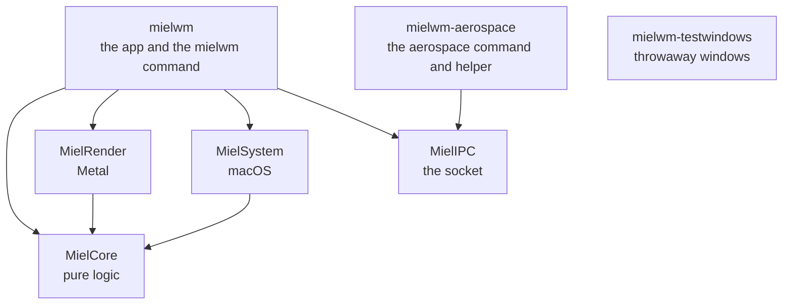
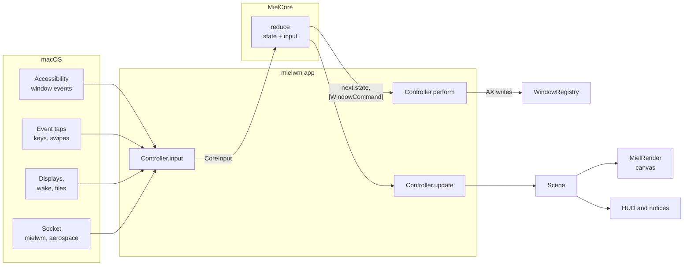

# Architecture

How mielwm's code fits together: the modules, the words it uses, and the path an event takes from macOS to a moved window and a drawn frame. [CONTRIBUTING.md](CONTRIBUTING.md) has the rules for changing it.

## Words

These names mean the same thing in the code, the docs and the UI.

- **Canvas.** The one endless surface every window lives on. `CanvasState` in `MielCore` holds all of it.
- **Workspace.** A screen-sized slot in a row on the canvas. Slots 1 to 9 have AeroSpace's names, and later slots have none. A workspace's windows fill it as tiles or as a stack.
- **Floating window.** A window that belongs to no workspace and can sit anywhere on the canvas.
- **Tiles and stack.** A workspace's two layouts. AeroSpace calls the stack "accordion".
- **Parked window.** A window that is off camera. macOS keeps every window on a screen, so mielwm moves it to a park slot: a bottom corner of a display with 1 point showing. [Decision 0002](decisions/0002-park-windows-in-a-corner.md) explains why.
- **Camera.** What part of the canvas the screen shows, and how far zoomed out.
- **Overview.** The zoomed-out view of the whole canvas, drawn through the lens.
- **Lens.** The curved distortion at the overview's edges.
- **HUD.** What floats over the overview: the search field, its results, the key hints and the ⌥Tab switcher.
- **Notice.** A small panel over the desktop, like the workspace pill or a toast.
- **Scene.** Everything the renderer needs for one frame, built by `MielCore`.
- **Test copy.** A mielwm started with `--manage-only`, its own socket and its own config directory, so it never touches your windows.

## Modules

The package has four libraries and three executables. Arrows point at what a module imports.

- **MielCore** is the logic, and it's pure: no AppKit, no windows, no timers, no clock. Workspaces, tiling, the camera, search, the overview's keys, the configuration format and the AeroSpace import live here, and so do most of the tests. [Decision 0001](decisions/0001-one-pure-reducer.md) explains why.
- **MielRender** draws the overview with Metal: the lens, window pictures, the minimap, and the window names and workspace pills on the canvas. It reads a `Scene` and knows nothing else. Its shaders compile at runtime from source strings, because the Command Line Tools have no `metal` compiler.
- **MielSystem** talks to macOS: Accessibility to read and move windows, the event taps for shortcuts and swipes, ScreenCaptureKit for window pictures, displays, wallpapers, the file watcher, and the link to status bars that speak AeroSpace.
- **MielIPC** is the socket protocol the app and the `mielwm` command share. The `aerospace` command speaks the same protocol with plain Darwin calls and doesn't link it, so it starts without loading Foundation: status bars run it many times a second.
- **mielwm** is the app. It wires the modules together and owns the overlay windows, the HUD, the notices, the Settings window, the menu bar item and onboarding. It's also the `mielwm` command-line tool. `Controller.swift` is the center.
- **mielwm-aerospace** is the `aerospace` command that status bars like Barik run, and the hidden helper app that tells them AeroSpace is running. [Decision 0004](decisions/0004-aerospace-helper.md) explains why.
- **mielwm-testwindows** opens throwaway windows, so system tests never move real ones.

Tests mirror the modules: `MielCoreTests`, `MielRenderTests`, `MielIPCTests`, `MielSystemTests`, and `mielwmTests` for the app's own logic. The test-only `TOMLDecoder` dependency, pinned to the version Barik uses, lets the tests read the status bar configs mielwm edits the way Barik does.

## How an event moves through

Every change to mielwm's state goes through one function. `CanvasState.send(_:)` in [Reducer.swift](Sources/MielCore/Reducer.swift) takes one `CoreInput`, updates the state and returns a list of `WindowCommand`s. The app calls it on its live state, then carries those commands out and draws what changed. `reduce(_:_:)` is the same step as a pure function, returning a new state instead of changing one, for tests and anywhere a copy is easier.

1. **Something happens.** `WindowRegistry` turns Accessibility notifications into `SystemEvent`s: a window appeared, moved, closed or took focus. The event tap turns shortcuts into `Action`s, and the swipe monitor turns three-finger swipes into actions. The IPC server turns `mielwm` and `aerospace` commands into actions too.
2. **The controller passes it to Core.** `Controller.input(_:)` wraps each one as a `CoreInput`. Before an input that would open the overlay, it tries the input on a copy of the state, and waits for fresh window pictures if the overlay would otherwise open on stale ones.
3. **Core decides.** `reduce` updates workspaces, layouts, the camera and the HUD, and returns the window moves to make. Time is an input too. While something animates, the controller sends `.tick(seconds)`, from the overlay's display link or a timer, and Core's springs advance on those ticks. When nothing moves, no ticks arrive and mielwm sleeps.
4. **The controller carries out the commands.** `Controller.perform` hands `setFrame`, `focus`, `close` and `minimize` to `WindowRegistry`, which writes them through Accessibility. A test copy never takes focus.
5. **The screen catches up.** `Controller.update` compares the state before and after. It shows or hides the overlay, builds a `Scene` for the renderer, updates the notices and the menu bar, saves the layout, and reports workspaces to the status bar.
6. **macOS answers.** The windows move, and Accessibility reports the new frames as `windowFrameChanged` events. Those go through the same loop, so Core always works from what macOS says happened, not from what it asked for.

Because the reducer is pure, a test can build a `CanvasState`, send it inputs and check the commands that come out, with no windows and no waiting. `ReducerTests.swift` and its neighbours in `Tests/MielCoreTests` work this way.

## Threads

Core runs on the main thread, inside `Controller`. In `WindowRegistry`, every Accessibility call for an app runs on that app's own serial queue, so a hung app stalls only itself, for at most 0.25 seconds a call. Its events still reach the controller on the main queue, in the order the app reported them. ScreenCaptureKit delivers frames on its own queue, and the renderer reads the newest frame for each window when it draws.

## Decisions

The [decisions](decisions/) folder records the choices that shape everything else, with what was considered and what each one costs.

- [0001. One pure reducer](decisions/0001-one-pure-reducer.md)
- [0002. Park windows in a corner](decisions/0002-park-windows-in-a-corner.md)
- [0003. A self-signed certificate](decisions/0003-self-signed-certificate.md)
- [0004. A helper that answers as AeroSpace](decisions/0004-aerospace-helper.md)

Add a record when a choice would surprise someone reading the code, or when undoing it later would be expensive. Copy the shape of an existing one: context, decision, consequences.
