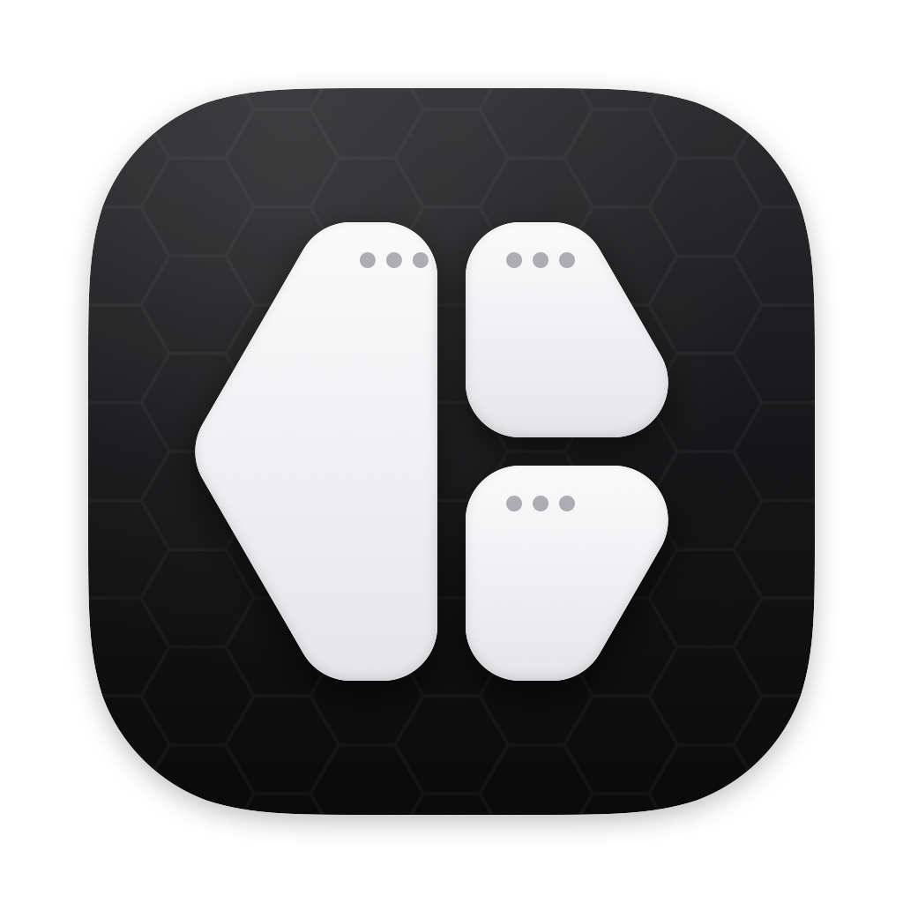

  

<h1 align="center">mielwm</h1>

A tiling window manager for macOS that keeps every window on one endless canvas.

  <a href="https://wm.miel.my">Website</a> ·
  <a href="https://github.com/mielsense/mielwm/releases/latest">Download</a> ·
  <a href="https://wm.miel.my/docs">Documentation</a> ·
  <a href="CHANGELOG.md">Changelog</a>

Windows tile into numbered workspaces the way AeroSpace does it, and `⌥1` to `⌥9` switch between them. Three fingers on the trackpad swipe to the next one. When you lose track of something, `⌃⌥G` zooms out through a curved lens to every window as a live picture, and typing a few letters takes you to the one you meant.

It's a menu bar app, and your windows stay ordinary macOS windows. At rest it uses about 0.01% of one CPU core and 89 MB of memory.

## Install

Download `mielwm.dmg` from the [latest release](https://github.com/mielsense/mielwm/releases/latest) and drag mielwm into Applications. It needs macOS 15 or later on Apple silicon. It's signed but not notarized, so the first time, open it once and then allow it in System Settings > Privacy & Security > Open Anyway.

[Getting started](docs/getting-started.md) covers the two permissions it asks for, and building it yourself.

## A few keys

| Keys | What it does |
| --- | --- |
| `⌥1` … `⌥9` | Go to a workspace. |
| `⌥⇧1` … `⌥⇧9` | Move the window there. |
| `⌥/`, `⌥,`, `⌥.` | Tiles, stack, float. |
| `⌥` arrows | Focus the window that way. |
| `⌃⌥G` | Zoom out to the overview. |

They follow AeroSpace's defaults, and Settings changes any of them. [Keyboard](docs/keyboard.md) has the full list.

## Documentation

The docs are also on [wm.miel.my](https://wm.miel.my/docs), with search.

- [Getting started](docs/getting-started.md)
- [Workspaces and layouts](docs/workspaces.md)
- [The overview](docs/overview.md)
- [Keyboard](docs/keyboard.md)
- [Trackpad and mouse](docs/trackpad.md)
- [Settings and the menu bar](docs/settings.md)
- [Configuration file](docs/configuration.md)
- [Command line](docs/command-line.md)
- [AeroSpace and Barik](docs/aerospace.md)
- [Performance](docs/performance.md)
- [Troubleshooting](docs/troubleshooting.md)
- [Development](docs/development.md)

## Contributing

Bug reports and pull requests are welcome. [CONTRIBUTING.md](CONTRIBUTING.md) explains how to build and test without touching your own windows.

## License

mielwm is under the [MIT License](LICENSE). It includes code adapted from [Phantomat](https://github.com/kaolti/phantomat), under the BSD 3-Clause License, as [NOTICE](NOTICE) explains.
