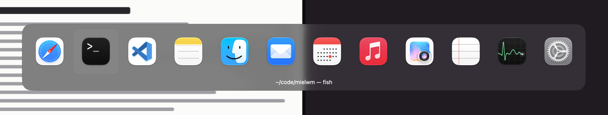

# Focus and switching

Move between windows with the arrows, jump back to the last one with `⌥Tab`, and decide what happens at a workspace's edge.

## Focus by direction

`⌥` with an arrow focuses the nearest window that way. `⌥⇧` with an arrow moves the focused window that way: it swaps with the tile next to it, or nudges a floating window one grid step.

| Keys | What it does |
| --- | --- |
| `⌥←` `⌥→` `⌥↑` `⌥↓` | Focus the nearest window that way. In a stack, the previous or next window. |
| `⌥⇧←` `⌥⇧→` `⌥⇧↑` `⌥⇧↓` | Swap tiles, or nudge a floating window. Hold to keep going. |

## At the edge of a workspace

Focus and move stop at the edge of the workspace, the way AeroSpace's do. To have them go on into the next workspace, turn on Settings > Layout > Focus and move past the edge. Then `⌥→` on the rightmost tile focuses the nearest window on the workspace to the right, and `⌥⇧→` carries the window there.

They always roam freely in two cases:

- In the [overview](overview.md), where the arrows reach every window on the canvas.
- When new windows float, set in Settings > Layout > New windows.

## Recent windows

`⌥Tab` is a window switcher, like `⌘Tab` for windows:

- Tap `⌥Tab` to go back to the last window you used, on any workspace.
- Hold `⌥` and press `Tab` again to walk further back. A list of your recent windows shows, and letting go of `⌥` switches.
- `⌥⇧Tab` walks the other way.

In a [stack](stacks.md), `⌥Tab` steps through the stack's windows instead.

## The last workspace

The Last workspace action goes to the workspace you were on before, and again comes back. It has no key until you give it one in Settings > Keyboard, under Workspaces. From a terminal it's `mielwm workspace-back-and-forth`.

Settings > Layout > Workspace key goes back does the same from the workspace keys: on workspace 3, `⌥3` takes you back to the one before.

## Close and minimize

Close window and Minimize window act on the focused window. Close works like a click on its close button, so the app may still ask to save. Neither has a key until you give it one in Settings > Keyboard, under Windows.

After you close, minimize or hide the focused window, you stay on the same workspace and the most recent window on screen takes the focus.

## What has the focus

Window keys like `⌥T` act on the focused window. When you click the desktop, a dialog or an app mielwm leaves alone, no managed window has the focus, so those keys do nothing until you pick a window again.
