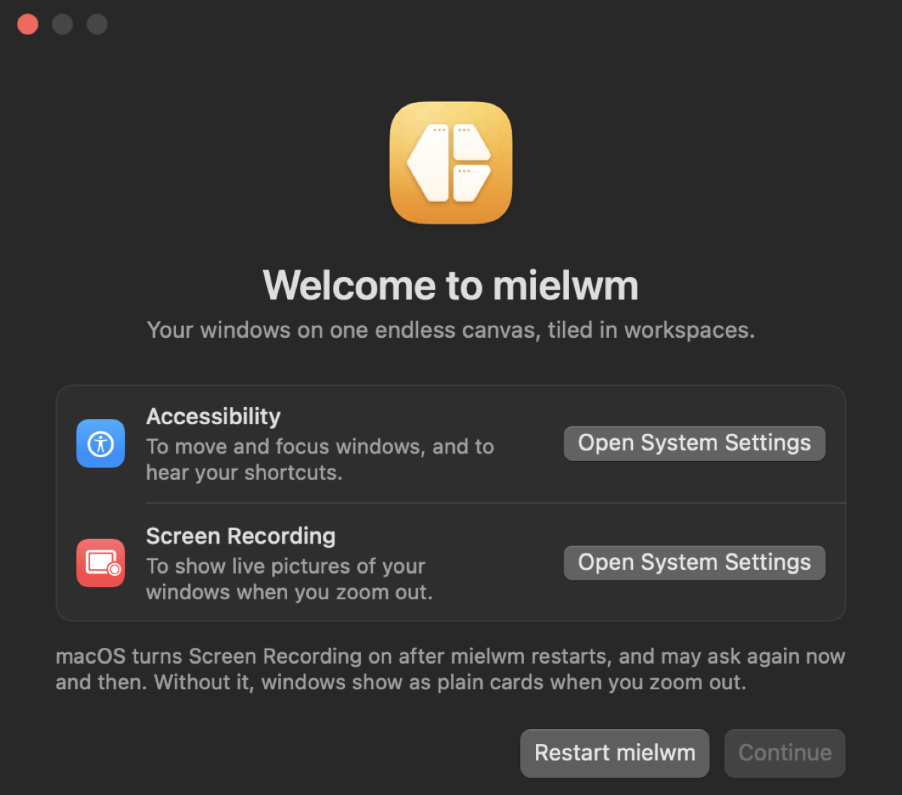

# Getting started

Install mielwm, give it the two permissions it needs, and have your windows tiled in a couple of minutes.

## Requirements

mielwm runs on macOS 15 or later, on Apple silicon. Use a single Space and turn off "Displays have separate Spaces" (more on that [below](#before-you-start)).

## Install

Download `mielwm.dmg` from the [latest release](https://github.com/mielsense/mielwm/releases/latest), open it and drag mielwm into Applications.

mielwm is signed, but not notarized by Apple, so the first time you open it macOS says it can't check the developer. Open it once, then go to System Settings > Privacy & Security and choose Open Anyway. You only do this once. Updates are signed with the same identity, so macOS keeps your permissions across them.

### Build it yourself

You need the Command Line Tools (`xcode-select --install`). Xcode isn't required.

```sh
git clone https://github.com/mielsense/mielwm.git
cd mielwm
scripts/build-app.sh --install
open ~/Applications/mielwm.app
```

`--install` copies the app to `~/Applications`, and quits a running copy first so its windows go back on screen. A local build is signed with a "mielwm Dev" identity that the script creates once, so your permissions survive rebuilds. [Development](development.md) explains the details.

## Permissions

mielwm asks for two, both under System Settings > Privacy & Security.

Accessibility lets it move and focus windows and catch its shortcuts. Without it mielwm can't do anything.

Screen Recording gives it the live window pictures in the [overview](overview.md). macOS applies this one only after mielwm restarts, and asks again every so often. Without it everything still works, but the pictures are blank cards.

The first launch shows both, with a button that opens the right page for each.



## Before you start

Quit AeroSpace, or any other window manager. Two of them moving the same windows fight each other. If AeroSpace is running, mielwm offers to quit it and manages nothing until it's gone. Set `start-at-login = false` in `~/.config/aerospace/aerospace.toml` so it doesn't come back. If SwipeAeroSpace runs too, mielwm offers to quit both. [AeroSpace and Barik](aerospace.md) covers moving your setup over.

Turn off "Displays have separate Spaces" under System Settings > Desktop & Dock > Mission Control, then log out and back in. With it on, a window can't sit across two displays. mielwm reminds you once.

Use one Space. mielwm doesn't support Spaces or native fullscreen apps.

## First steps

Every window you had open lands on its own workspace, numbered from 1. Try these:

- `⌥1` to `⌥9` go to a workspace.
- `⌥⇧2` moves the focused window to workspace 2 and follows it there.
- `⌥/` tiles windows side by side, `⌥,` stacks them, `⌥.` floats one.
- `⌃⌥G` zooms out to see everything. Type to search, `Return` to go.
- Three fingers left or right on the trackpad switch workspaces.

If you used AeroSpace, the keys already match. [Keyboard](keyboard.md) has the full list, and Settings lets you change any of them.
