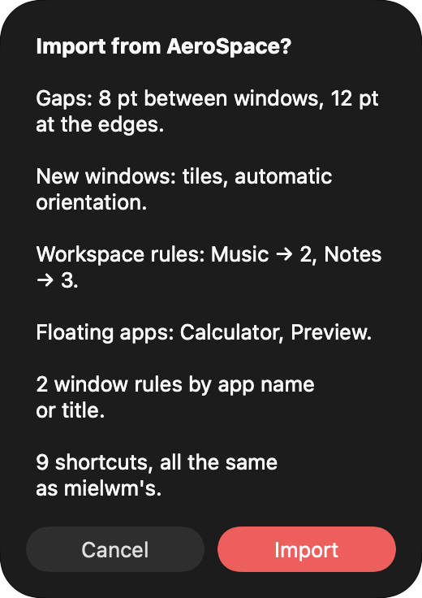

# Import your config

Bring your AeroSpace gaps, layout, rules and keys over to mielwm in one step.

## On the first launch

The very first time mielwm starts, before it has a config of its own, it looks for `~/.config/aerospace/aerospace.toml`, or `~/.aerospace.toml`. If it finds one, it imports the gaps, the layout and the rules on its own and tells you what it took. It leaves the keys alone, since mielwm's defaults already match AeroSpace's.

## Importing later

1. Open Settings > AeroSpace.
2. Under AeroSpace, click Import… next to Import from AeroSpace. The line above the button shows which file it reads.
3. Read the list of what will change, and click Import to apply it, or Cancel.

Importing again replaces the rules an earlier import added. Settings you changed yourself stay unless the import has a value for them.

## What it reads

### Gaps

`[gaps]` becomes the gaps in Settings > Layout, including AeroSpace's per-monitor form. `monitor."built-in"` becomes the built-in display's top gap, and the plain value the other displays' top gap.

### Layout

`default-root-container-layout` becomes Settings > Layout > New windows, with `accordion` becoming a stack. `default-root-container-orientation` becomes the orientation.

### Window rules

Each `[[on-window-detected]]` block turns into one of these:

| AeroSpace | mielwm |
| --- | --- |
| `if.app-id` with `run = "move-node-to-workspace N"` | The app in Settings > Windows > Workspace rules. |
| `if.app-id` with `run = "layout floating"` | The app in Settings > Windows > Floating apps. |
| `if.app-name-regex-substring` or `if.window-title-regex-substring` | A [window rule](window-rules.md) with the same `run`. |

Blocks with other conditions or commands are skipped.

### Keys

`[mode.main.binding]` keys whose command mielwm has come over as shortcuts:

| AeroSpace | mielwm action |
| --- | --- |
| `focus left` and the other directions | Focus |
| `move left` and the other directions | Move window |
| `workspace N`, `workspace next`, `workspace prev` | Go to workspace, Next and Previous workspace |
| `workspace-back-and-forth` | Last workspace |
| `move-node-to-workspace N` | Move window to workspace, also as the first of several commands |
| `layout tiles`, `layout accordion`, `layout floating` | Tiles, Stack, Float or tile |
| `fullscreen` | Fullscreen |
| `resize smart +50`, `resize smart -50` | Grow, Shrink |
| `resize smart\|width\|height` with any other amount | `resize` with the same amount |
| `close` | Close window |
| `macos-native-minimize` | Minimize window |

A workspace key with `--auto-back-and-forth` turns on Settings > Layout > Workspace key goes back. `alt-tab` keeps mielwm's window switcher, since that's what `⌥Tab` does here.

## What it skips

Binding modes, such as service mode, and commands with no mielwm action, like `join-with` and `split`, aren't imported. [What's different](aerospace.md) lists what mielwm does its own way.
