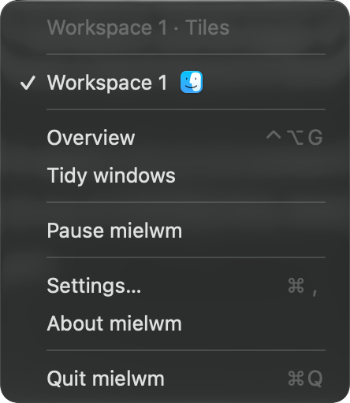

# Menu bar and indicators

What the mielwm menu bar item shows, what's in its menu, and the notices that appear over your windows.

## The menu bar item

Settings > Menu bar > Menu bar item decides what the item shows:

| Choice | What it shows |
| --- | --- |
| All workspaces | The numbers of the workspaces that have windows, with the current one filled. This is the default. |
| Current only | Only the current workspace's number, for a crowded menu bar or one cut short by the notch. |
| Icon | The mielwm icon. |

When another menu bar app already shows your workspaces, Icon keeps them from showing twice. Turning on Settings > AeroSpace & Barik > Work with Barik switches All workspaces to Icon for you. See [AeroSpace-compatible apps](compatible-apps.md).

While the [configuration file](configuration.md) has errors, a warning sign shows instead of the numbers.

## The menu

Click the item to open its menu. From top to bottom:

- What mielwm is doing: the current workspace and its layout, like "Workspace 3 · Stack", or that it's paused, or what it's waiting for, such as a permission or AeroSpace quitting.
- A warning when secure input is on. See below.
- A line for each workspace that has windows, with the icons of up to four of its apps and a check on the current one. Click one to go there. Point at it to see its apps' names.
- Overview, Tidy windows, and Pause mielwm or Resume mielwm.
- Config has problems…, when the config file has errors.
- Settings…, About mielwm and Quit mielwm.

### Pausing

Pause mielwm puts every window back on a screen and leaves them alone until you click Resume mielwm. It's handy when an app misbehaves under tiling and you want normal macOS for a minute. Quitting puts the windows back too.

### Secure input

When an app turns on secure input, macOS hides your keys from every other app, mielwm included, so its shortcuts stop working. The menu then says "Secure input is on, shortcuts may not work".

Password fields turn it on for a moment. Terminal's Secure Keyboard Entry keeps it on until you turn it off in the Terminal menu. Quit or switch away from the app that holds it, and the shortcuts work again.

## On-screen indicators

mielwm shows short notices over your windows. They never take focus or clicks, and they use the same [glass style](overview.md#glass) as the overview.

### The workspace pill

Each time you switch workspaces, a pill at the bottom of the display shows the numbers of the workspaces with windows, with the current one filled. It's there for 0.7 seconds and helps when the menu bar is on another display or hidden. Turn it off with Settings > Menu bar > Show workspace on switch.

### The stack strip

Going to a [stack](stacks.md#the-stack-strip), or bringing another of its windows to the front, shows its windows at the top of the stack, with where you are, like "2 of 4".

### Messages

Actions outside the overview that have something to say, like Tidy windows, show a short message on screen, such as "Tidied 4 windows".

## VoiceOver

VoiceOver says the workspace you switch to, like "Workspace 3, stack, 4 windows", the app selected in the `⌥Tab` switcher, and messages like "Tidied 4 windows". It speaks the workspace even with the pill turned off.
