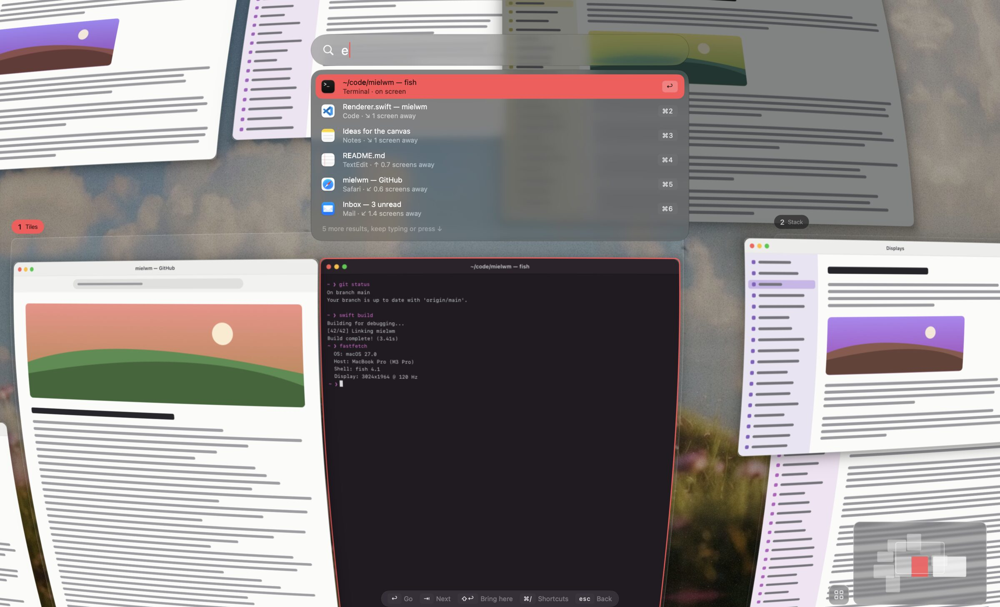
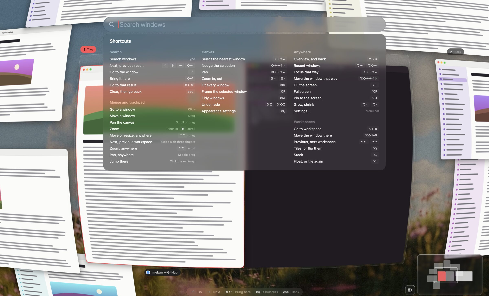

# The overview

Zoom out to see every window at once as a live picture, then search or point to go anywhere.

## Opening it

`⌃⌥G` zooms out, and `⌃⌥G` again comes back. The view pulls back through a curved lens so the edges of the canvas bend away, and the workspace you were on sits in the middle. `Esc` goes back to exactly where you started.

`⌃⌥G` stays clear of AeroSpace's keys, but it's a stretch to press. `⌥Space` is easier, if no launcher already has it. Change it in Settings > Keyboard.

You can also open it from the menu bar item's menu, or with `mielwm overview` from a terminal.

## Search

Start typing as soon as it opens. The search field is a capsule at the top of the screen, like Spotlight, with the results in a card below it. mielwm searches window titles and app names, and the results narrow with each letter.

Every word you type has to appear somewhere, with its letters together. So `fas` finds `fastfetch`, and `term git` finds a Terminal window with git in its title. Case and accents don't matter, and dead keys and input methods work as usual. Windows that don't match fade, so you can still see where they are.

| Keys | What it does |
| --- | --- |
| `↑` `↓`, `Tab` `⇧Tab` | Move through the results. With no search, `Tab` walks your recent windows. |
| `⌘1` … `⌘9` | Go straight to that result. |
| `Return` | Go to the selected window. |
| `⇧Return` | Bring the selected window to where you are. |
| `⌘⌫` | Clear the search. |
| `Esc` | Clear the search, then go back. |

In the search field, `⌃U`, `⌃W`, `⌃N` and `⌃P` work the way they do in any Mac text field.

## Moving around

| Keys | What it does |
| --- | --- |
| Arrows | Select the nearest window that way. |
| `⇧` arrows | Nudge the selected window. |
| `⌘` arrows | Pan. |
| `⌘=`, `⌘-` | Zoom in, out. |
| `⌘0` | Fit every window, or every match while searching. |
| `⌘F` | Frame the selected window. |
| `⌘A` | Tidy every floating window onto the grid, grouped by app. |
| `⌘Z`, `⌘⇧Z` | Undo, redo moves and tidying. |
| `⌘,` | Open Settings at Appearance. |
| `⌘/` | Show every key. |

The `⌃` versions of these keys, like `⌃0` and `⌃Z`, work too, and so does `F1` for the key list.

## With the pointer

Click a window to go to it, or drag it somewhere else, onto another workspace too. Scroll with two fingers or drag the empty canvas to pan, and pinch or `⌘`-scroll to zoom. Hovering a window selects it and shows its name.

To drive the overview by keyboard only, turn off Settings > Trackpad & mouse > Use the pointer in the overview.

## The minimap

The minimap in the corner shows the whole canvas, your workspaces and the part you're looking at. Click it to jump there. The button next to it tidies your floating windows. Turn it off with Settings > Overview > Show the minimap.

## The lens

The bend at the edges is the lens. It keeps the windows around the edge in view without shrinking everything else. Settings > Overview > Lens sets its Strength and Magnification, or turns it off with Bend the edges.

With Reduce Motion on in System Settings > Accessibility, mielwm cuts between views instead of flying.

## Glass

The search field, the results, the shortcuts sheet, the key hints and the `⌥Tab` switcher are glass panels that macOS draws. Settings > Appearance > Glass style picks what they're made of:

- Liquid glass is clear and bends the edges of what's behind it, like macOS 26. It needs macOS 26 and is the default there.
- Frosted blurs what's behind it, like earlier macOS versions. Before macOS 26, panels are always frosted.

With Reduce Transparency on in System Settings > Accessibility, every panel is solid. The same style applies to the [notices on the desktop](menu-bar.md#on-screen-indicators).

## Window pictures

The pictures are live while the overview is open, and need the Screen Recording permission. Without it, windows show as plain cards. A window that sits still costs almost nothing to show, and one playing video updates up to 60 times a second. [Performance](performance.md) has the numbers.

VoiceOver reads the selected window, its app and its place among the search results.
