# Settings

Every pane of the Settings window, what each setting does, and its name in the config file.

## Opening Settings

Open Settings from the mielwm menu bar item, with `⌘,` in the overview, or with `mielwm settings` from a terminal. It opens at the pane you used last.

The sidebar lists eleven panes in groups. The search field at its top finds a pane by its name or by a setting in it: type "gap" and Layout shows, with Gaps under it.

Changes apply to your windows right away. Each one is saved to `~/.config/mielwm/config.json` a moment after you stop changing it, so dragging a slider is one write. Edits you make to the file yourself show up in the open window as soon as you save. The [configuration file](configuration.md) page lists every key, including the ones Settings doesn't show.

## General

Start mielwm when you log in, and choose how it remembers and animates your windows.

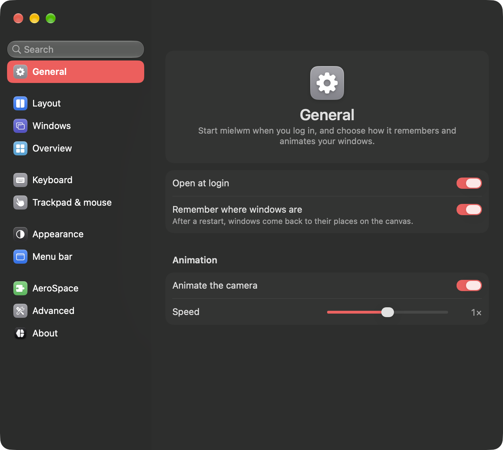

| Setting | What it does | Config key |
| --- | --- | --- |
| Open at login | Starts mielwm when you log in. Works when mielwm runs from mielwm.app. If macOS asks, allow it in System Settings > General > Login Items. | none |
| Remember where windows are | After a restart, windows come back to their places on the canvas. | `canvas:remember_layout` |
| Animation > Animate the camera | The overview flies between views. Off, it cuts. | `animation:enabled` |
| Animation > Speed | How fast it flies, from a quarter to four times the default. | `animation:speed` |

## Layout

How new windows tile, and the gaps around them and the screen edges. [Layouts and gaps](layouts.md) explains each one.

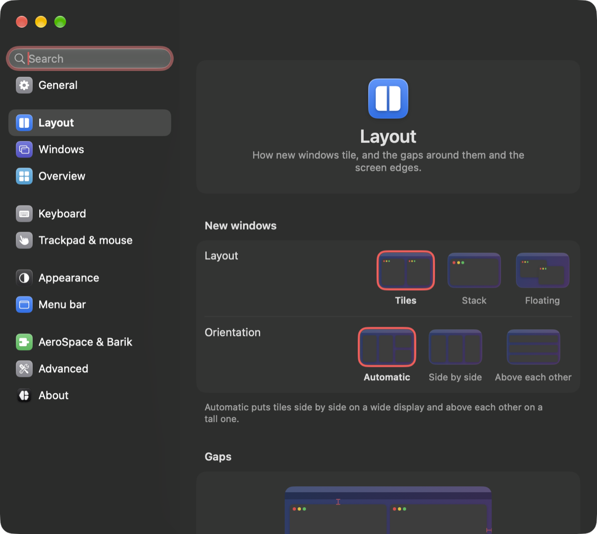

| Setting | What it does | Config key |
| --- | --- | --- |
| New windows > Layout | Tiles, Stack or Floating, for new workspaces. | `layout:default` |
| New windows > Orientation | Automatic, Side by side, or Above each other. | `layout:orientation` |
| Stacks > Peek edges | Off, or 1 to 16 points of the windows behind a stack's front one. | `layout:stack_peek` |
| Gaps | Between windows, side by side and above each other, and the left, right and bottom edges. | `gaps:*` |
| Gaps > Top edge | Automatic, Same as other edges, or Custom. | `gaps:outer_top_external` |
| Gaps > Top gap | The gap at the top. In Custom, one for the built-in display and one for the others. | `gaps:outer_top` |
| Workspaces > Workspace key goes back | The key of the workspace you're on takes you to the one before. | `layout:auto_back_and_forth` |
| Workspaces > Focus and move past the edge | `⌥` arrows and `⌥⇧` arrows go on into the next workspace instead of stopping. | `layout:cross_workspaces` |

## Windows

Apps whose windows float above the tiles, and apps that always open on one workspace. [Floating windows](floating.md) has the details.

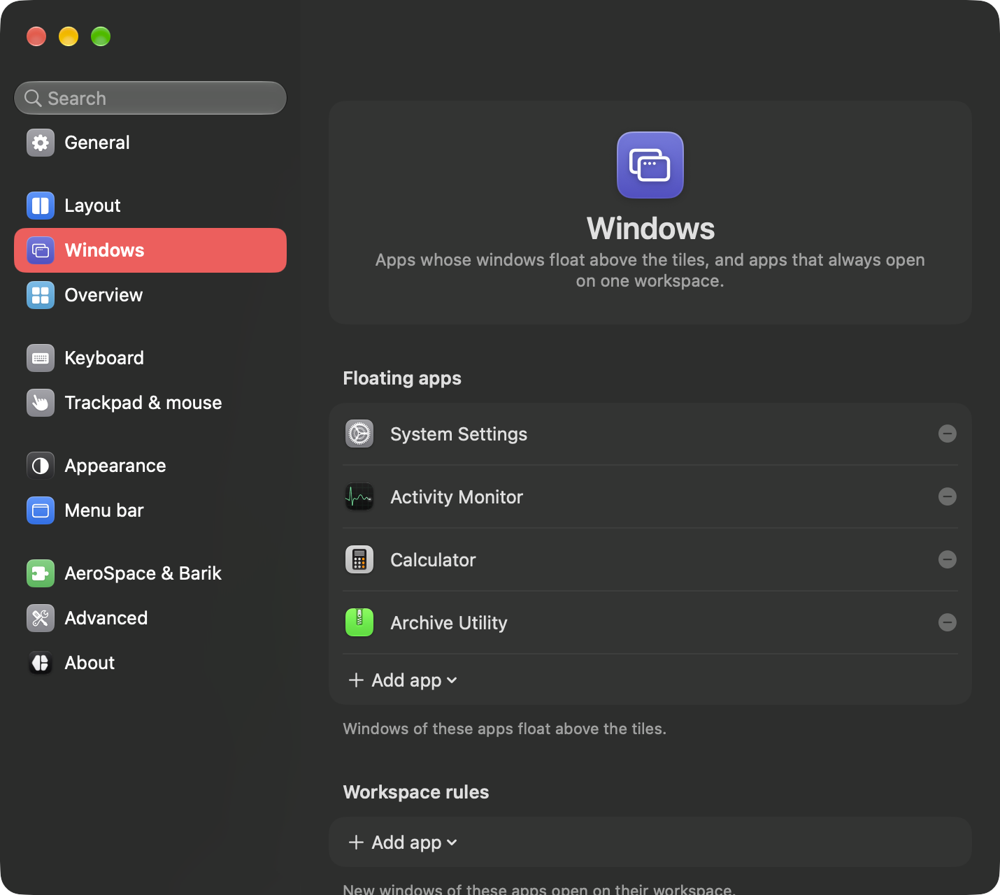

| Setting | What it does | Config key |
| --- | --- | --- |
| Floating apps | Windows of these apps float above the tiles. | `layout:floating_apps` |
| Workspace rules | New windows of these apps open on their workspace. | `layout:workspace_rules` |

Add app, under each list, picks a running app or opens Finder to choose one. [Window rules](window-rules.md) by name or title live only in the config file.

## Overview

How far the canvas zooms out, the lens at its edges, and what shows on it. [The overview](overview.md) explains each part.

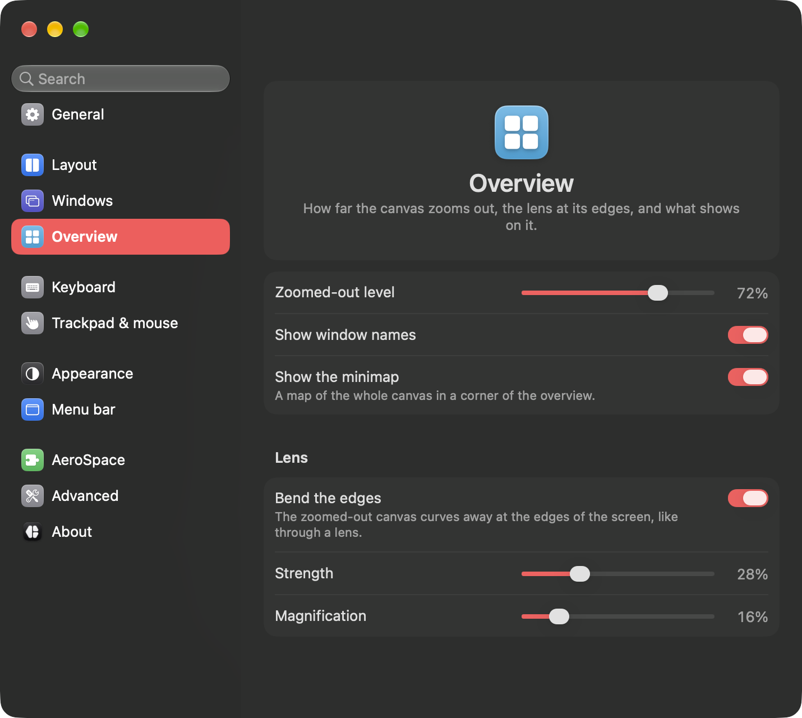

| Setting | What it does | Config key |
| --- | --- | --- |
| Zoomed-out level | How far the overview zooms out when it opens, from 10% to 95%. | `canvas:initial_zoom` |
| Show window names | The name of the selected window. | `navigator:labels` |
| Show the minimap | A map of the whole canvas in a corner. | `canvas:minimap_enabled` |
| Lens > Bend the edges | The canvas curves away at the screen's edges. | `distortion:enabled` |
| Lens > Strength | How strongly it bends. | `distortion:strength` |
| Lens > Magnification | How far the canvas extends under the bent edge. | `distortion:edge_scale` |

## Keyboard

Every shortcut, grouped by what it does: Overview, Windows, Layout, Workspaces, Focus & move, and mielwm. Click a shortcut, then type the new keys. `Esc` cancels and `Delete` clears it. The search field at the top finds a shortcut by name.

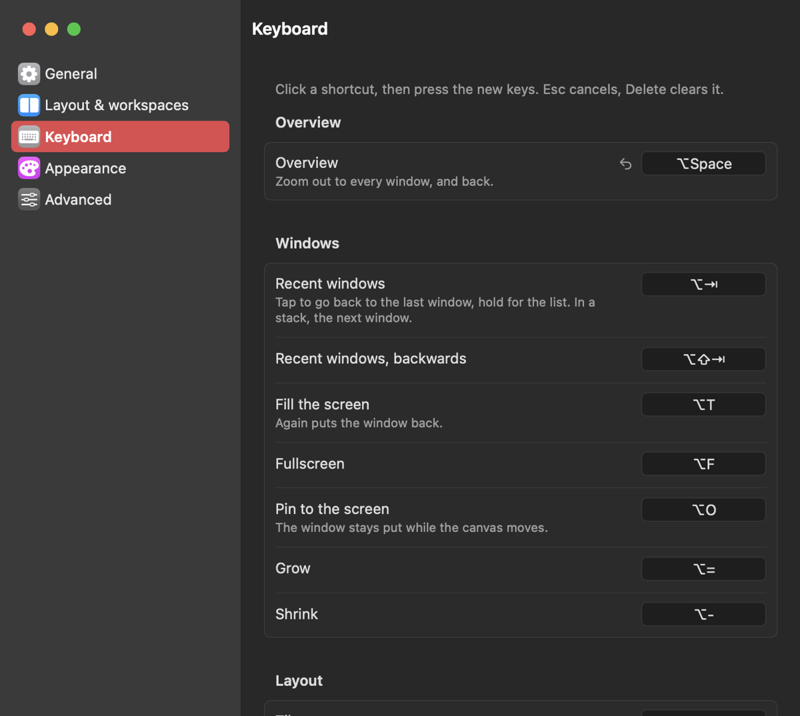

Below the groups, From config.json lists keys you bound in the file to other actions, and In the overview lists the overview's own keys. Restore defaults… gives every action its default shortcut back. [Keyboard](keyboard.md) covers recording, families of keys and conflicts.

## Trackpad & mouse

Swipes, the pointer in the overview, and the keys you hold to drag a window. [Trackpad and mouse](trackpad.md) has every gesture.

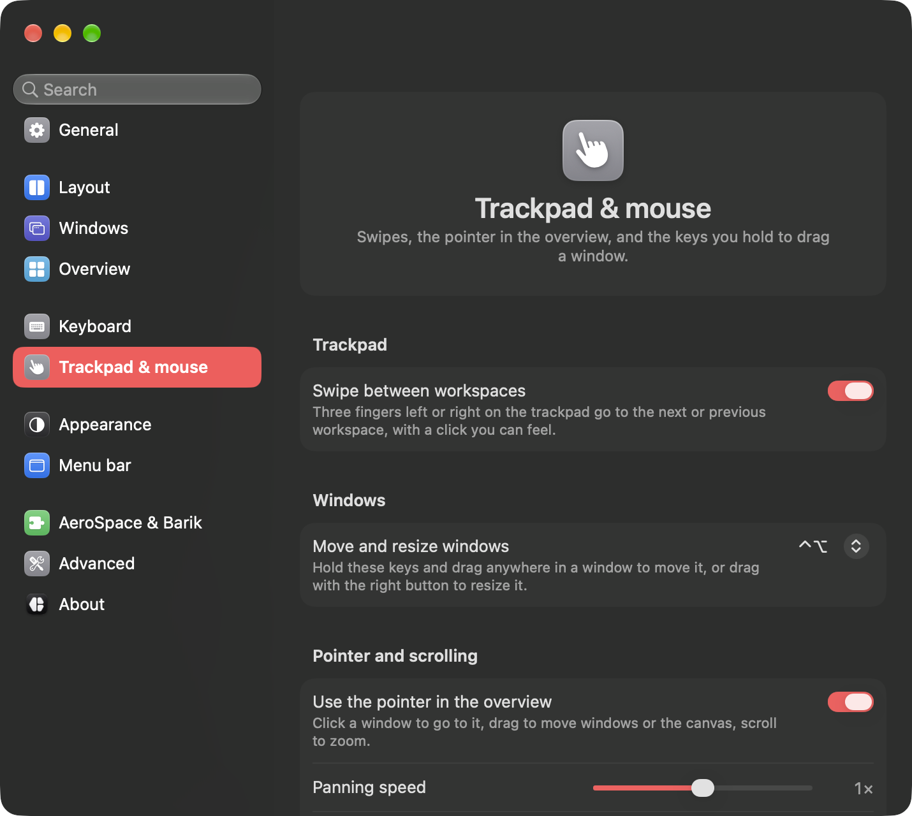

| Setting | What it does | Config key |
| --- | --- | --- |
| Trackpad > Swipe between workspaces | Three fingers left or right go to the next or previous workspace. A warning shows when macOS's own swipe gets in the way. | `input:swipe_workspaces` |
| Windows > Move and resize windows | The keys you hold to drag a window from anywhere, or resize it with the right button. `⌃⌥` by default. | `input:move_modifier` |
| Pointer and scrolling > Use the pointer in the overview | Clicks, drags, scrolling and hover in the overview. | `navigator:pointer` |
| Pointer and scrolling > Panning speed | How far a drag pans the canvas, from a quarter to four times the default. | `input:pan_sensitivity` |
| Pointer and scrolling > Zoom speed | How fast the scroll wheel zooms, from a quarter to four times the default. | `input:scroll_factor` |

## Appearance

The overview's accent color, glass, background, grid and windows. A live preview of the overview sits at the top, so every change shows as you make it.

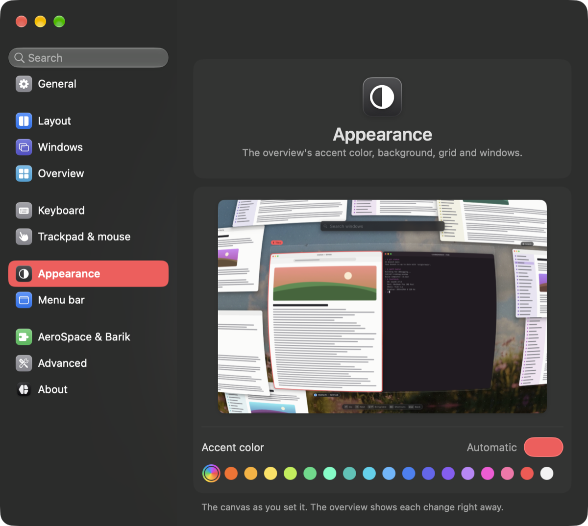

| Setting | What it does | Config key |
| --- | --- | --- |
| Accent color | Automatic follows the accent color in System Settings. Or pick one of 17 presets, or any color with the color well. | `navigator:accent` |
| Glass style | Liquid glass or Frosted, for the overview's panels and the notices. Liquid glass needs macOS 26. See [Glass](overview.md#glass). | `appearance:glass` |
| Background > Show the desktop picture | Your desktop picture behind the canvas. | `wallpaper` |
| Background > Dim | How much the background darkens, 0% to 90%. | `canvas:background_dim` |
| Background > Blur, Blur amount | Blur the desktop picture, and how much. | `blur`, `blur_strength` |
| Grid > Show the grid | Dots or lines on the canvas. | `canvas:grid_enabled` |
| Grid > Style | Dots or Lines. | `canvas:grid_style` |
| Grid > Opacity | How strong the grid is, 0% to 50%. | `canvas:grid_opacity` |
| Windows > Corner rounding | Window corners in the overview, 0 to 40 points. | `window:rounding` |
| Windows > Shadows | Shadows under windows in the overview. | `window:shadow` |

## Menu bar

What the mielwm item in the menu bar shows. [Menu bar and indicators](menu-bar.md) describes the item, its menu and the notices.

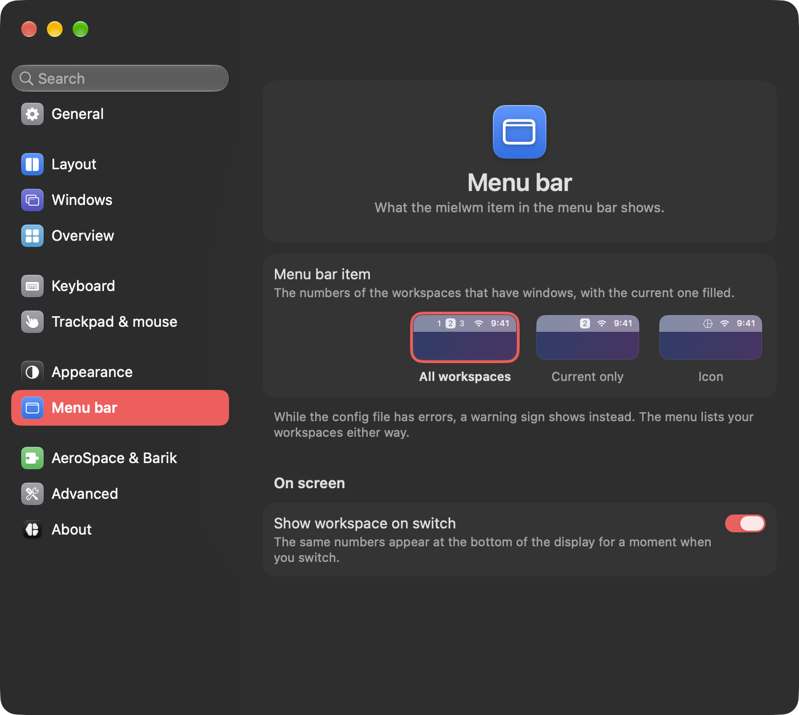

| Setting | What it does | Config key |
| --- | --- | --- |
| Menu bar item | All workspaces, Current only, or Icon. | `menubar:style` |
| On screen > Show workspace on switch | The workspace numbers show at the bottom of the display for a moment when you switch. | `notices:workspace` |

## AeroSpace

Show your workspaces in a menu bar app built for AeroSpace, or bring your AeroSpace settings over.

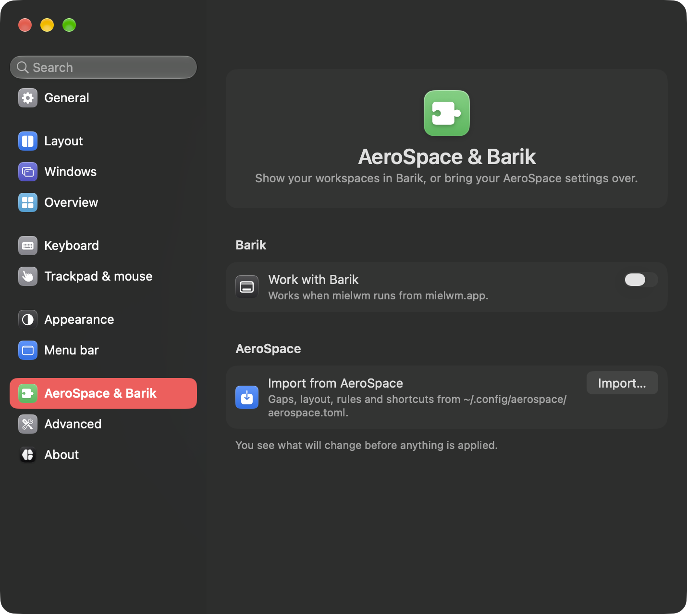

| Setting | What it does | Config key |
| --- | --- | --- |
| Work with AeroSpace-compatible apps | Points a supported menu bar app at mielwm, so it shows mielwm's workspaces and windows. mielwm asks before it edits the app's config and relaunches it. See [AeroSpace-compatible apps](compatible-apps.md). | `integrations:barik` |
| Import from AeroSpace > Import… | Reads your AeroSpace config and shows what it will change before anything is applied. See [Import your config](import.md). | none |

## Advanced

The config file, the command-line tool and a fresh start.

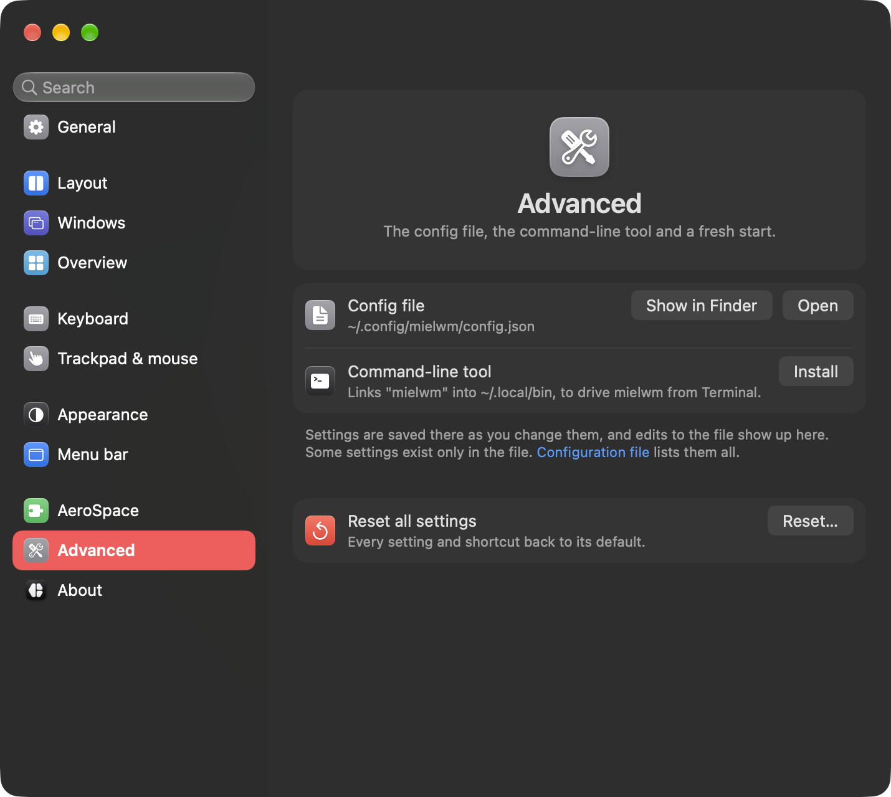

| Setting | What it does |
| --- | --- |
| Config file > Show in Finder, Open | Shows `~/.config/mielwm/config.json` in Finder, or opens it in your editor. When the file has errors, Some settings could not be read lists them above. |
| Command-line tool > Install | Links the `mielwm` command into `~/.local/bin`. Remove takes it out again. See [Command line](command-line.md). |
| Reset all settings > Reset… | Every setting and shortcut back to its default. The config file goes to the Trash, so you can get it back. |

## About

The version you run, and links to the website, these docs, the changelog, the source code and the license. About mielwm in the menu bar item's menu opens this pane.

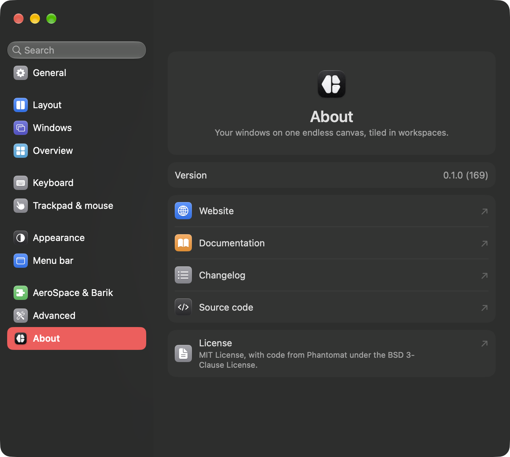
