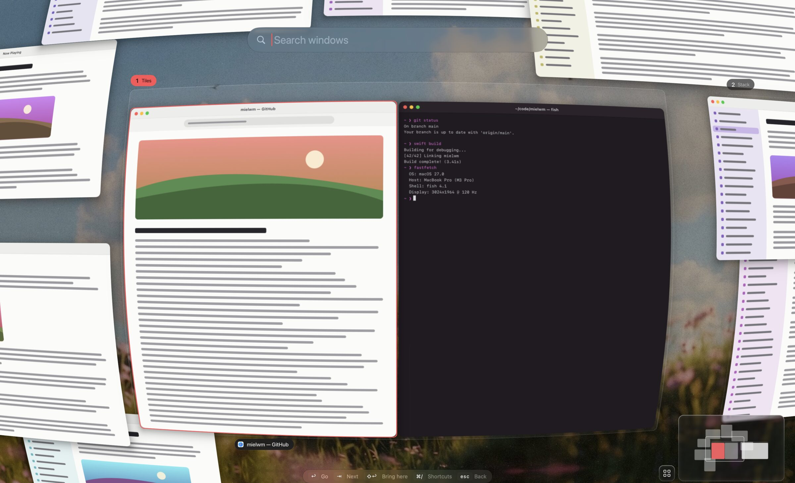

# Workspaces and layouts

Windows live on one endless canvas, grouped into numbered workspaces that tile them the way AeroSpace does.

## The canvas

Every window has a place on the canvas, a surface much larger than your screens. Normally you look at one screen-sized part of it, and mielwm puts the real windows wherever the canvas says.

Windows outside that part wait in a bottom corner of a display, tucked away with one point still on screen. AeroSpace hides windows the same way, because macOS doesn't let an app truly hide another app's window. They stay ordinary macOS windows the whole time, and mielwm puts them all back on screen when it quits or pauses.

## Workspaces

A workspace is a screen-sized area of the canvas. Workspaces 1 to 9 sit side by side in a fixed row, so `⌥3` always lands in the same place. A workspace with no windows disappears once you leave it, and its number is free again.

| Keys | What it does |
| --- | --- |
| `⌥1` … `⌥9` | Go to that workspace. |
| `⌥⇧1` … `⌥⇧9` | Move the focused window to that workspace and go with it. |
| `⌃←`, `⌃→` | The previous or next workspace that has windows. They stop at the first and last. |
| Three fingers left, right | The same, from the trackpad. See [Trackpad and mouse](trackpad.md). |

Switching is instant, with no animation. The menu bar shows the numbers of the workspaces that have windows, with the current one filled.

## Layouts

A workspace lays its windows out one of two ways, and any window can float instead.

### Tiles

Tiles split the screen between the workspace's windows, side by side on a wide display and above each other on a tall one. The gaps come from Settings > Layout, and match AeroSpace's by default: 8 points between windows and 12 around the edge.

A tiled window can't be dragged smaller than its tile. Drag the edge between two tiles to move it, or use `⌥=` and `⌥-` to grow and shrink the focused tile. `⌥⇧` with an arrow swaps a window with its neighbour, and past the last tile it moves to the next workspace.

`⌥/` tiles the workspace. Pressed again, it flips between side by side and above each other.

### Stack

A stack shows one window at a time at full size, like AeroSpace's accordion. `⌥,` stacks the workspace and `⌥,` again goes back to tiles. In a stack, `⌥←` and `⌥→` step through its windows, and so does `⌥Tab`. Zoomed out, a stack looks like a fanned deck of cards.

### Floating

`⌥.` floats the focused window. A floating window keeps whatever size and place you give it. `⌥.` again tiles it back into the workspace it sits on. A floating window belongs to the workspace it's on, so it's still there when you come back.

Some apps always float, because their windows don't make sense as tiles: System Settings, Activity Monitor, Calculator and Archive Utility by default. Windows that can't be resized float too.

## New windows

A new window joins the workspace you're on, next to the focused window. It takes the workspace's layout, which is tiles unless you change it in Settings > Layout.

Workspace rules send an app's windows to a fixed workspace, so Spotify can always open on 2 and Discord on 1. Add them in Settings, or import your AeroSpace `on-window-detected` rules ([AeroSpace and Barik](aerospace.md)).

When mielwm starts, every window that's already open gets a workspace of its own, unless a rule says otherwise. That way nothing starts as a pile of tiny tiles.

## Fill, fullscreen and pin

`⌥T` fills the screen with the focused window, keeping the gaps, and `⌥T` again puts it back. `⌥F` does the same without gaps. The menu bar stays visible either way. `⌥O` pins a floating window to the screen, so it stays put while the canvas moves under it.

## More than one display

The workspace you go to lands on the display under the pointer. The other displays keep showing whatever part of the canvas sits there. Gaps can differ on the built-in display and the others, for a menu bar that only covers one of them.

## A status bar at the top

Settings > Layout > Top edge decides how much room the tiles leave at the top of each display.

- Automatic, the default, finds a status bar such as Barik or SketchyBar along the top of each display and adds its height to the top gap. A display without one gets the top gap alone. Next to the setting you see what it found on the display the Settings window is on, like "Barik, 40 pt". mielwm looks again when an app opens or quits and when displays change.
- Same as other edges uses the top gap alone on every display.
- Custom keeps the top gap for the built-in display and takes your own number for the others.

A menu bar that hides itself needs nothing. macOS already leaves its room when it shows.
